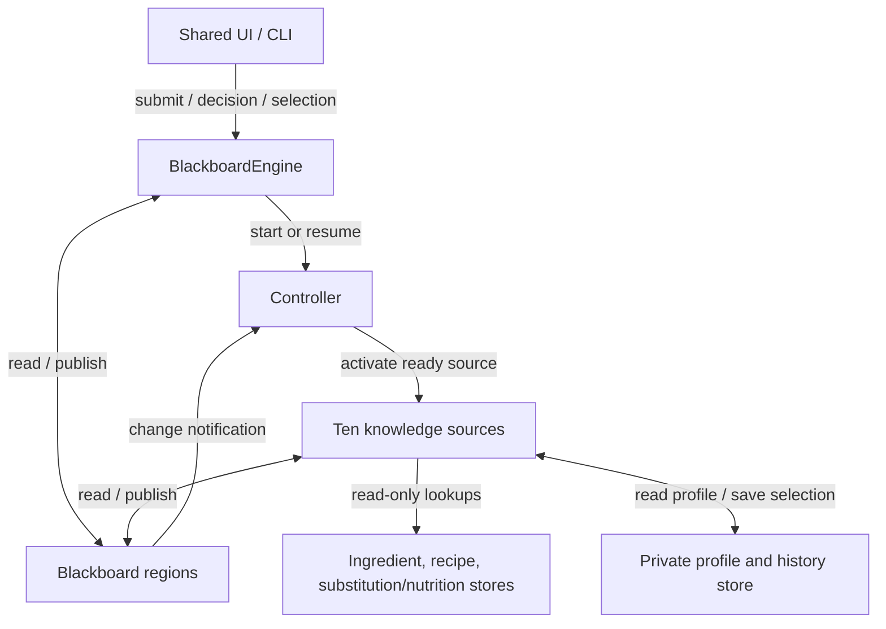
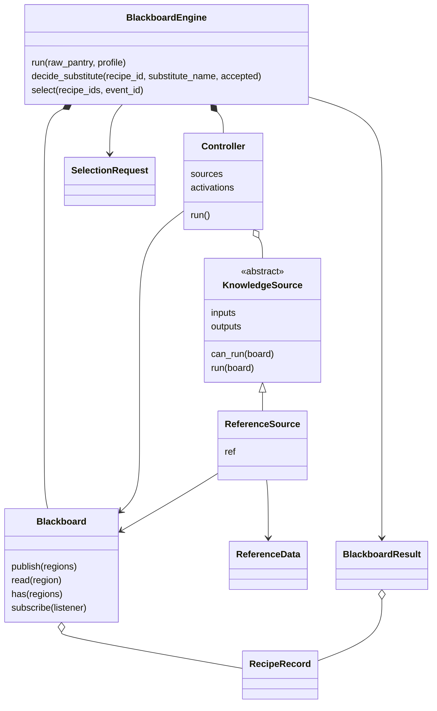

# Architecture B design and mapping

## Level 2 component view

The UI box is Aaron's integration boundary. The B engine and command-line demo
are implemented here; the shared Streamlit UI is not implemented by this PR.
Knowledge-source activation uses procedure calls. Blackboard reads/writes are
data-access connectors. Change notifications are synchronous in-process events.

The ten knowledge sources are separate implementations, listed individually
in the mapping below. Their only inter-source communication is through regions.
`PreferenceWeighter` is the only source that invokes history persistence.

## Class view

All ten concrete source classes inherit `ReferenceSource`, which inherits
`KnowledgeSource`. `RecipeRecord` contains a common `Recipe`, quantity `Gap`
objects, common `Nutrition`, and its recommendation/trace fields. Inputs use
the team's common `UserProfile`, `PantryItem`, and `ReferenceData` classes.

## Component/connector-to-code mapping

| Architecture element | Implementing classes / functions | File |
|---|---|---|
| Blackboard and regions | `Blackboard` | `smart_shelf/arch_b/blackboard.py` |
| Data-access connector | `Blackboard.read`, `Blackboard.publish`, snapshot copying and transitive invalidation | `blackboard.py` |
| Change notification connector | `Blackboard.subscribe`, publication events, `Controller.events` | `blackboard.py`, `controller.py` |
| Controller and activation connector | `Controller.run`, readiness/priority selection, dietary barrier | `controller.py` |
| Knowledge-source interface | `KnowledgeSource`, `ReferenceSource` | `controller.py`, `knowledge_sources.py` |
| Normalize | `InputNormalizer`, `normalize` | `knowledge_sources.py`, `normalization.py` |
| Match | `RecipeMatcher` | `knowledge_sources.py` |
| Dietary check | `DietaryChecker` | `knowledge_sources.py` |
| Gap detection | `GapDetector` | `knowledge_sources.py` |
| Substitution | `SubstituteFinder` | `knowledge_sources.py` |
| Nutrition | `NutritionCalculator` | `knowledge_sources.py` |
| Freshness | `FreshnessScorer` | `knowledge_sources.py` |
| Preference/history | `PreferenceWeighter`, `SelectionRequest`, `BlackboardEngine._save_once` | `knowledge_sources.py`, `engine.py` |
| Rank | `Ranker` | `knowledge_sources.py` |
| Shopping list | `ShoppingListBuilder` | `knowledge_sources.py` |
| Reference-store connector | Common `ReferenceData` helpers and common `load_reference_data` | Existing `smart_shelf/common/` |
| Profile/history connector | Common `load_profile`, `save_selection`; injected selection writer for tests | Existing common data access, `engine.py` |
| UI-facing facade | `BlackboardEngine`, `BlackboardResult` | `engine.py`, `models.py` |
| Executable demo | `main` | `__main__.py` |

## Key differences from A

| Concern | A implementation | B implementation |
|---|---|---|
| Data connector | Queue-backed pipes carrying recipe records | Snapshot reads and region publications |
| Control | Fixed threaded filter chain with end markers | Readiness predicates, fixed priority, and dietary barrier |
| Restricted recipes | Removed from the stream, with exclusion summary | Retained as candidates with exclusion status; omitted from recommendations |
| Decision updates | Fresh pipeline run | Dependency invalidation and affected-source reactivation |
| Termination | End marker, thread completion/error checks | No ready sources, with configuration and progress checks |
| Failure isolation | Thread errors propagated by pipeline | Exceptions stop analysis; invalid downstream regions cannot be returned |
| Comparison reuse | Shared reference data; own temporary model types | Shared reference data and common model types; B result records |

The component diagram, class view, and table should be exported into the team's
final PowerPoint and Word README together. Any later design change should be
reflected in all three, with its rationale documented relative to the proposal.
